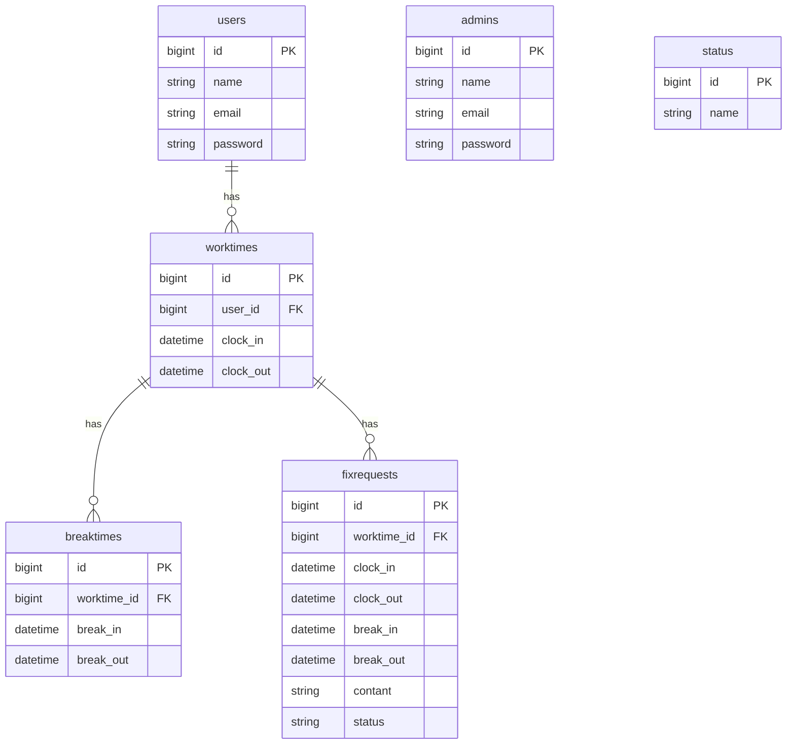

# 勤怠管理アプリ

## アプリケーション概要

一般ユーザーがログインし、出勤・休憩・退勤の打刻を行う勤怠管理アプリです。

## 使用技術

- PHP 8.5.6
- Laravel 10.50.3
- MySQL 8.4
- Docker
- Laravel Sail
- Vite

## 実装機能

- ユーザー新規登録
- ログイン・ログアウト
- 出勤打刻
- 休憩開始・休憩終了の打刻
- 退勤打刻
- 勤怠状況の表示

## 環境構築

### 1. リポジトリをクローン

```bash
git clone https://github.com/YukaUshiyama/attendance-app.git
cd attendance-app
```

### 2. Composerパッケージをインストール

```bash
composer install
```

### 3. 環境設定ファイルを作成

```bash
cp .env.example .env
```

必要に応じて `.env` の環境変数を設定。

### 4. Dockerコンテナを起動

```bash
./vendor/bin/sail up -d --build
```

### 5. アプリケーションキーを生成

```bash
./vendor/bin/sail artisan key:generate
```

### 6. データベースのマイグレーション

```bash
./vendor/bin/sail artisan migrate
```

### 7. フロントエンドの依存パッケージをインストール・ビルド

```bash
npm install
npm run build
```

## ER図



## URL

- アプリケーション：http://localhost
- phpMyAdmin：http://localhost:8080
- Mailpit：http://localhost:8025

## データベースについて

データベースのテーブルはマイグレーションで作成します。

```bash
./vendor/bin/sail artisan migrate
```

シーディング未実装です。
